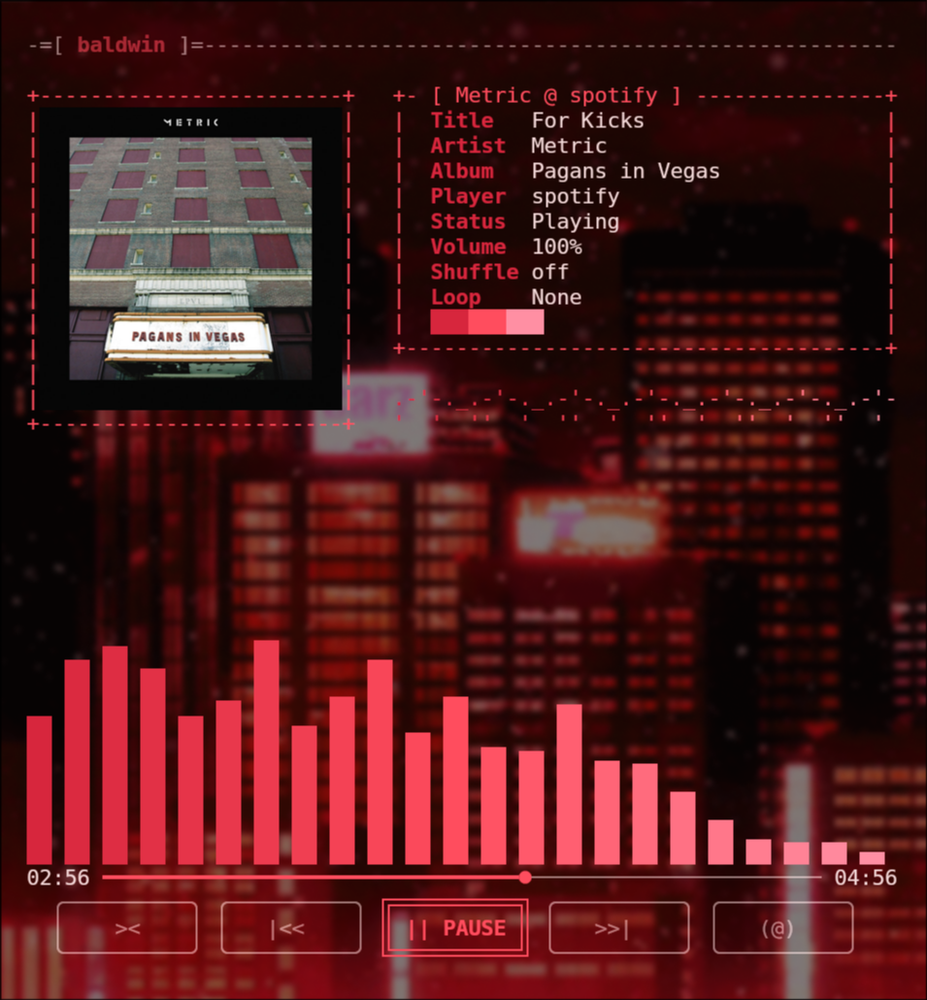

# baldwin

A terminal now-playing visualizer for Linux.



- Cover art and fastfetch-style track info
- Audio-reactive spectrum bars (captures whatever your system is playing)
- Clickable time bar and stylized ASCII media buttons
- Works with any MPRIS player: Spotify, mpv, Firefox, VLC, ...
- Follows your terminal theme (kitty, Alacritty, WezTerm, foot, Ghostty and more), and the
  background is transparent so your terminal opacity shows through

## Requirements

- Linux with a PipeWire audio server (uses `pw-cat` to capture the visualizer audio)
- [`playerctl`](https://github.com/altdesktop/playerctl) for track info and controls
- Python 3.10+
- A terminal with the kitty graphics protocol (kitty, WezTerm, ...) for true cover art.
  Other terminals fall back to a lower-resolution cover.

Install the system packages with your package manager, e.g.

```sh
# Arch
sudo pacman -S playerctl pipewire
# Debian/Ubuntu
sudo apt install playerctl pipewire-bin
# Fedora
sudo dnf install playerctl pipewire-utils
```

## Install

Clone the repo and run the installer. It detects your distro, installs the system packages
and puts a `baldwin` command on your PATH:

```sh
git clone https://github.com/Society-g/baldwin
cd baldwin
./install.sh
```

Prefer to pick the script yourself?

```sh
./install/install-ubuntu.sh   # Ubuntu / Debian / Mint
./install/install-fedora.sh   # Fedora / RHEL
./install/install-arch.sh     # Arch / Manjaro / EndeavourOS
./install/install-nix.sh      # Nix / NixOS
```

Then open a new terminal and run `baldwin`.

### Manual install

With [pipx](https://pipx.pypa.io) (recommended):

```sh
pipx install git+https://github.com/Society-g/baldwin
baldwin
```

Or from a clone:

```sh
git clone https://github.com/Society-g/baldwin
cd baldwin
pipx install .
```

### NixOS / Nix

`./install/install-nix.sh` builds baldwin and puts a `baldwin` command in your Nix profile
(it ships with `playerctl` and `pw-cat` wired in, so there is nothing else to install).
Or run it without installing:

```sh
nix-shell --run 'python -m baldwin'
```

## Uninstall

```sh
./uninstall.sh           # remove baldwin (pipx or Nix, whichever you used)
./uninstall.sh --purge   # also delete its cache and config
```

System packages (`playerctl`, PipeWire, `pipx`) are left in place since other programs may use them.

## Controls

| Key | Action |
| --- | --- |
| `space` | play / pause |
| `n` / `p` | next / previous |
| `←` / `→` | seek -5s / +5s |
| `↑` / `↓` | volume up / down |
| `s` | toggle shuffle |
| `l` | cycle loop (none / playlist / track) |
| `q` | quit |

The time bar and the buttons are clickable too.

## Theming

baldwin picks its accent colors from your terminal theme, in this order:

1. **Your override:** the `BALDWIN_ACCENT` environment variable or
   `~/.config/baldwin/config.toml` (see below).
2. **The live terminal palette.** baldwin asks the terminal for its colors (an OSC 4 query),
   which works in kitty, Alacritty, WezTerm, foot, Ghostty, iTerm2, GNOME Terminal and other
   VTE terminals, Konsole, xterm and more.
3. **Terminal config files** if the terminal doesn't answer: kitty (including `include`d theme
   files), Alacritty (including `import`s), foot, Ghostty and `~/.Xresources`.
4. A default red.

The accent is a three-step ramp built from one ANSI color, **red** by default: the normal
color, the bright color, and a lightened bright color. Text and background are your
terminal's own, so a transparent terminal stays transparent.

Pick another hue or set exact colors, either as an environment variable:

```sh
BALDWIN_ACCENT=blue baldwin                      # red green yellow blue magenta cyan
BALDWIN_ACCENT="#ff5555,#ff8888,#ffbbbb" baldwin # 1 to 3 hex colors, dark to light
```

or in `~/.config/baldwin/config.toml`:

```toml
accent = "cyan"
# accent = ["#ff5555", "#ff8888", "#ffbbbb"]
```

Colors are read when baldwin starts, so relaunch it after changing your theme.

## Troubleshooting

- **Bars don't move:** check `pw-cat` is installed and a player is actually playing.
- **"Nothing playing":** `playerctl status` must report a player.
- **No cover art:** not every player publishes `mpris:artUrl`.

## Development

With [Nix flakes](https://wiki.nixos.org/wiki/Flakes), `nix develop` opens a shell with
Python, every dependency, `playerctl`, `pw-cat` and pytest, pinned by `flake.lock`:

```sh
nix develop        # or: nix-shell, or: pip install -e . pytest
python -m pytest
python -m baldwin  # run from your checkout
```

`nix build` builds the package and `nix run` launches it. To update the pinned nixpkgs, run
`nix flake update`.

## License

MIT
